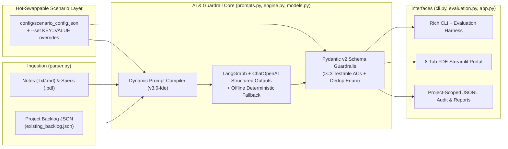

# Configurable FDE Smart Backlog Assistant (Certified-Level RDE Submission)

A scenario-driven, schema-enforced AI engineering solution built for the **Accenture Certified-Level RDE (Rapid / Forward Deployed Engineer) Hands-On Project**.

By externalizing all domain, persona, rubric, and integration variables into [`config/scenario_config.json`](config/scenario_config.json) (and hot-swappable presets in [`config/presets/`](config/presets/)), this engine adapts instantly to **any engineering or client scenario** without modifying a single line of Python code.

---

## 1. Problem Definition (Required Step 1)

> [!NOTE]
> **Evaluation Guide & Agent Asset Inspection**:
> - To check **only the AI Agent, Subagents, MCPs, Hooks, Prompts, and Tools**, inspect the dedicated [**`agent/`**](file:///c:/Proyectos/FDE_accenture/FDE%20PROJECT/agent) folder. It isolates all AI agent components cleanly away from the UI code.
> - The directory [**`src/backlog_assistant/`**](file:///c:/Proyectos/FDE_accenture/FDE%20PROJECT/src/backlog_assistant) is the **active execution package** that powers the Streamlit web dashboard (`app.py`), the CLI interface (`cli.py`), and the automated pytest evaluation suite. **Do not delete `src/backlog_assistant/`**, as it is needed to execute and test the application!

### The Engineering Challenge
Forward Deployed Engineers (FDEs) and Agile engineering teams lose hours every sprint translating fragmented, high-noise inputs—raw meeting notes, incident postmortems, and formal compliance PDFs—into structured, sprint-ready backlog items. Worse, manual backlog grooming frequently introduces:
1. **Duplicate Tickets**: Re-creating stories that are already in progress (`DUPLICATE`).
2. **Missed Scope Updates**: Failing to link new operational constraints to existing backlog items (`UPDATES_EXISTING`).
3. **Architectural Conflicts**: Accepting new compliance requirements that contradict existing technical stories (`CONFLICT`).
4. **Requirement Hallucinations**: Inventing unverified SLAs or retention windows instead of flagging ambiguities for stakeholder sign-off.

### Target Use Cases Included (`data/samples/`)
1. **Use Case 1 — Sprint Planning & Stakeholder Sync (`01_sprint_planning_notes.txt`)**: Extracts net-new federated OIDC/SAML SSO requirements (`NEW`), catches a duplicate CSV export request (`FIN-101` $\rightarrow$ `DUPLICATE`), and upgrades an existing webhook retry story (`FIN-104` $\rightarrow$ `UPDATES_EXISTING`).
2. **Use Case 2 — SEV-1 Incident Postmortem (`02_incident_postmortem.md`)**: Translates a payment gateway cascading timeout postmortem into an adaptive circuit-breaker story (`NEW`) and tightens upstream timeout/bulkhead limits on `FIN-105` (`UPDATES_EXISTING`).
3. **Use Case 3 — Security & Compliance PDF Specification (`03_pci_compliance_spec.pdf`)**: Parses a PDF specification (`pypdf`), flags a direct PCI-DSS v4.0 encryption conflict against plaintext Redis caching (`FIN-106` $\rightarrow$ `CONFLICT`), and extracts an immutable S3 Object Lock audit trail story (`NEW`).

---

## 2. Solution Design & Parameterized Architecture (Required Step 2)



### Adapting to Any New Scenario in Seconds
Every domain variable is controlled via [`config/scenario_config.json`](config/scenario_config.json), environment variables, or CLI `--set` flags:

| Variable | Default (`scenario_config.json`) | Example Adaptation (`incident_triage_scenario.json`) |
| :--- | :--- | :--- |
| `domain_name` | `"Enterprise Cloud & FinTech Engineering"` | `"Site Reliability Engineering (SRE) & Cloud Ops"` |
| `agent_role` | `"Staff Forward Deployed Engineer (FDE)..."` | `"Principal Site Reliability Engineer (SRE)..."` |
| `output_item_label` | `"User Story"` | `"Remediation Action Item"` |
| `id_prefix` | `"STORY"` (`STORY-001`) | `"REM"` (`REM-001`) |
| `categories` | `["Feature", "Security/Compliance", ...]` | `["Immediate Mitigation", "Root-Cause Fix", ...]` |
| `priority_rubric` | P0–P3 Engineering & Compliance definitions | P0–P3 SEV-1 MTTR & Error Budget definitions |
| `github.repo` | `"RicardoRobinson1410/fde-smart-backlog-assistant"` | Any target GitHub `owner/repo` |

---

## 3. Quick Start & Setup Instructions (Required Step 4)

### Prerequisites
- Python 3.10+
- *(Optional)* `OPENAI_API_KEY` set in `.env` or environment. **Note for Reviewers**: If `OPENAI_API_KEY` is omitted (or `--offline` is passed), the engine automatically runs in **Deterministic Offline Replay Mode** so all commands, UI features, and tests work out-of-the-box with zero API setup.

### Installation & Environment Activation (Windows PowerShell)
```powershell
# Activate the pre-configured project virtual environment (bypasses Windows Store python stub)
.\.venv\Scripts\Activate.ps1

pip install -r requirements.txt
pip install -e .
python scripts/generate_sample_pdf.py
```

### Run CLI Analysis
```powershell
# 1. Analyze Sprint Planning Notes (TXT)
python -m backlog_assistant.cli analyze data/samples/01_sprint_planning_notes.txt

# 2. Analyze Incident Postmortem (MD)
python -m backlog_assistant.cli analyze data/samples/02_incident_postmortem.md

# 3. Analyze PCI-DSS Compliance Specification (PDF)
python -m backlog_assistant.cli analyze data/samples/03_pci_compliance_spec.pdf

# 4. Adapt variables on the fly for a custom scenario (--set key=value)
python -m backlog_assistant.cli analyze data/samples/02_incident_postmortem.md `
  --config config/presets/incident_triage_scenario.json `
  --set id_prefix=SRE --set "domain_name=Payment Gateway Reliability"

# 5. Run in offline deterministic replay mode (zero API key required)
python -m backlog_assistant.cli analyze data/samples/01_sprint_planning_notes.txt --offline
```

### Run Golden Evaluation Scorecard & Automated Tests (Required Step 3)
```powershell
# Run the 12-case Golden Evaluation Suite (offline deterministic baseline)
python -m backlog_assistant.cli evaluate --offline

# Run the 12-case Golden Evaluation Suite (Live OpenAI + AI Judge, requires OPENAI_API_KEY)
python -m backlog_assistant.cli evaluate

# Run the automated pytest verification suite (18 tests)
python -m pytest -v
```

### Launch Interactive Streamlit Workbench (8-Tab FDE Portal)
```powershell
python -m streamlit run src/backlog_assistant/app.py
```
The Streamlit portal includes:
1. **Ask ChatGPT**: Multi-turn conversational agent with `.txt`/`.md`/`.pdf` upload and HITL task approval.
2. **Kanban Board**: Jira-style drag-and-drop board synced with the active project's backlog JSON.
3. **Doc-to-Tasks Pipeline**: 4-stage batch extraction, deduplication, and HITL approval gate.
4. **FinOps & Cost Savings**: Per-stage model routing telemetry, budget alerts, and savings tracking.
5. **Agent Evaluation Lab**: 12-case golden dataset browser, custom test case creator, deterministic checks + calibrated AI Judge.
6. **Error & Log Explorer**: Searchable audit & security event inspector backed by project-scoped JSONL logs.
7. **Agent & MCP Graph**: Interactive 5-stage LangGraph/Subagent/MCP/Hook topology and reasoning stream.
8. **Project & Settings**: Multi-project switcher, isolated project creator (`backlog`, `samples`, `audit_log`, `evals`), and PII Shield toggle.

---

## 4. Prompt Engineering, Agent/MCP/Hooks Schemas & AI Usage Log (Required Step 5)

- **Prompt Engineering Evolution (`v1` $\rightarrow$ `v3`) & Architecture**: Detailed in [`docs/ARCHITECTURE_AND_PROMPTS.md`](docs/ARCHITECTURE_AND_PROMPTS.md).
- **Part 4 Council Interview Defense Guide**: Detailed in [`docs/INTERVIEW_PREP_GUIDE.md`](docs/INTERVIEW_PREP_GUIDE.md).
- **Workspace Agentic Customizations (`.agents/`)**:
  - Plugin Manifest: [`.agents/plugins/fde-backlog-kit/plugin.json`](.agents/plugins/fde-backlog-kit/plugin.json)
  - Subagents: [`backlog-auditor.md`](.agents/plugins/fde-backlog-kit/agents/backlog-auditor.md) & [`security-reviewer.md`](.agents/plugins/fde-backlog-kit/agents/security-reviewer.md)
  - MCP Servers Schema: [`.agents/plugins/fde-backlog-kit/mcp_config.json`](.agents/plugins/fde-backlog-kit/mcp_config.json)
  - Lifecycle Hooks Schema: [`.agents/plugins/fde-backlog-kit/hooks.json`](.agents/plugins/fde-backlog-kit/hooks.json) & [`scripts/hooks/pre_tool_gate.py`](scripts/hooks/pre_tool_gate.py)

